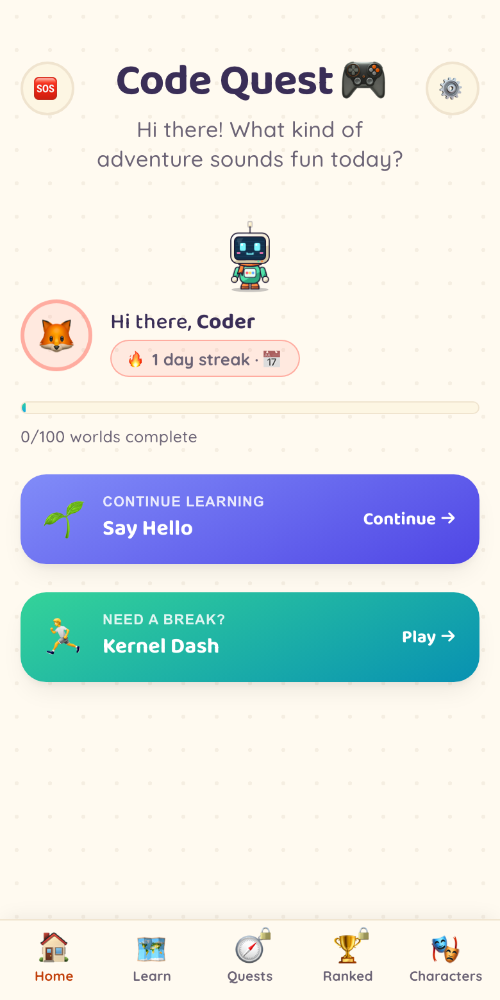
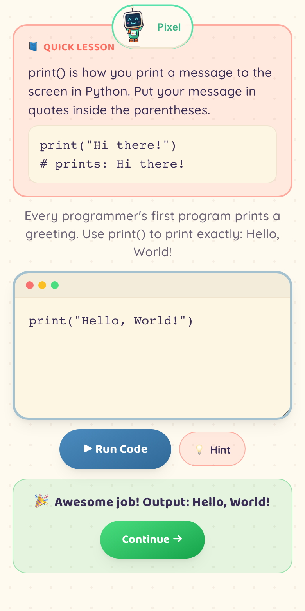
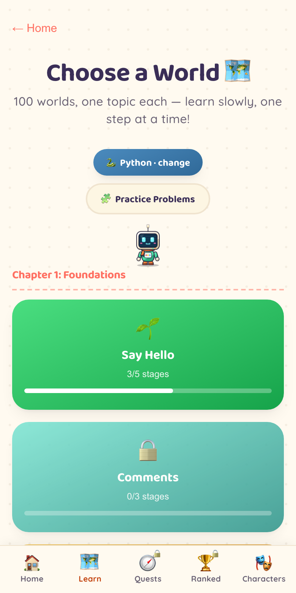

# Code Quest 🎮

A free, Duolingo-style coding game for kids and teens: learn to code through
bite-sized challenges that run real code in the browser, then put it to the
test in live player-vs-player ranked matches.

**▶ Play it: [codequest-learnfromzero.vercel.app](https://codequest-learnfromzero.vercel.app)** (no account needed)

<p align="center">
  
  
  
</p>

## Highlights

- **Real code, safely run in the browser.** JavaScript runs in a Web Worker
  and Python in [Pyodide](https://pyodide.org) (WebAssembly) in its own
  worker; React/HTML lessons render in sandboxed iframes. Every runner has a
  hard timeout, so an infinite loop can't freeze the page. C, C++ and Java
  compile on the [Wandbox](https://wandbox.org) API.
- **Live ranked multiplayer on Supabase.** Matchmaking, results and an
  ELO-style points swing run inside Postgres functions with Row Level
  Security, so the browser can't forge a score, a finish time or its rank.
  AI-generated match questions come from a Claude-powered Edge Function.
- **Security tested, not assumed.** `scripts/verify-schema.mjs` applies the
  real schema to a throwaway Postgres and attacks it as signed-in users
  (30 checks: reading others' data, forged points, planted questions,
  unsafe names). The site ships a strict Content-Security-Policy and HSTS.
- **Built for kids.** Guest-first (nothing leaves the device without an
  account), a filter that keeps emails and phone numbers out of public
  names, a parent lock, and WCAG checks with axe-core in light and dark mode.
- **Tested end to end.** Vitest unit tests, Playwright browser tests run
  under production security headers, and scripts that check all 16,577
  lessons' answers and hints really pass. CI runs all of it on every pull
  request; Vercel deploys `main`.
- **4 interface languages:** English, Spanish, Traditional Chinese, Korean.

**Stack:** React 19 · Vite · Supabase (Postgres, Auth, Realtime, Edge
Functions in Deno/TypeScript) · Claude API · Pyodide · Web Workers ·
Vitest · Playwright · GitHub Actions · Vercel

Working notes from development (QA report, roadmap, decision log) are in
[`docs/`](docs/).

## Features

- **100-world learning path** — one topic per world, broken into small
  gradually-harder steps, plus a separate **Practice Gym** of 50 optional
  drill worlds that opens after World 1. The first 12 worlds run real, graded code in
  **five languages**: JavaScript and Python run right in the browser
  (Python via [Pyodide](https://pyodide.org)), while **C, C++ and Java** run
  on the free [Wandbox](https://wandbox.org) online compiler (the learner's
  code is sent to it when they press Run — see the Privacy Policy). The rest
  are fast concept quizzes so every world works no matter which language you
  picked. Timed Ranked modes use JavaScript for C/C++/Java learners, since
  online compiling is too slow for them.
- **35 Side Quests** — optional courses on real tools: Git, Docker, SQL,
  React, HTML, CSS, PHP, AWS, Kubernetes, and AI/ML topics like Prompt
  Engineering, LangChain, LangGraph, Computer Vision, NLP, and RAG.
- **Ranked Mode** — real player-vs-player: 7 playable game modes (Code
  Race, Bug Hunt, Predict the Output, Code Golf, Showdown, Debug Duel,
  Chaos Round, plus a Relay mode awaiting real team matchmaking), picked
  via a daily-rotating slot-machine shuffle, then matched against a real
  opponent of similar rank (see `supabase/schema.sql`) — closest LP first,
  widening the search over time. Both players get identical content, and
  LP moves on a real, server-computed, zero-sum ELO-style swing based on
  who you actually beat. Questions scale across 7 difficulty tiers
  (Bronze → Grandmaster) that track your rank. Requires an account (not
  guest) to be matched.
- **12 unlockable characters** — a shared parametric SVG rig reskinned
  per character, each with a real mechanical bonus tied to their
  archetype (not just flavor text), unlocked through genuine progress.
- **Daily login rewards** — a calendar with a streak milestone ladder.
- **Guest-first accounts** — progress saves to this device by default;
  signing in with email syncs it via Supabase instead. No login is ever
  required to play.
- **4 languages** — English, Spanish, Traditional Chinese, and Korean UI
  (lesson content itself is English-only).
- Light/dark theme, following system preference or an explicit choice.

## Getting started

```bash
npm install
npm run dev
```

The app runs fully in **guest mode** out of the box — no setup required.
Progress is stored on-device via `localStorage`.

### Optional: real accounts (Supabase)

To let players log in and sync progress across devices, create a
[Supabase](https://supabase.com) project, run `supabase/schema.sql` in its
SQL editor, then copy `.env.example` to `.env.local` and fill in your
project's URL and anon key. Without this, Code Quest works exactly the
same — just guest-only.

## Scripts

| Command | What it does |
| --- | --- |
| `npm run dev` | Start the Vite dev server |
| `npm run build` | Production build to `dist/` |
| `npm run preview` | Preview the production build locally |
| `npm run lint` | Run oxlint |
| `npm test` | Unit tests (Vitest) |
| `npm run test:e2e` | Browser tests (Playwright) against the production build, with production security headers |
| `npm run verify` | Check every lesson's answer, hint and "Show solution" really pass |
| `npm run verify:db` | Apply `supabase/schema.sql` to a throwaway Postgres and test its security rules (needs `psql` + a local Postgres) |

## Deploying

The site is a static build (`dist/`), set up for **Vercel** (`vercel.json`):
production security headers (Content-Security-Policy, HSTS,
clickjacking protection, etc.) and long-term caching for hashed assets.
Any static host works if it sends the same headers.

1. Import the GitHub repo in Vercel (framework: Vite). Pushes to `main`
   then deploy automatically.
2. In Vercel → Settings → Environment Variables, set `VITE_SUPABASE_URL`,
   `VITE_SUPABASE_ANON_KEY`, `VITE_SITE_URL` (your domain, no trailing
   slash), `VITE_CONTACT_EMAIL`, and optionally `VITE_TURNSTILE_SITE_KEY`.
3. Add your domain in Vercel → Domains, then use the same address in
   Supabase → Auth → URL Configuration (Site URL + redirect URLs) and in
   the Edge Functions' `ALLOWED_ORIGINS` secret.
4. Run `supabase/schema.sql` in the Supabase SQL editor. It is safe to run
   again after every update (CI checks this).

### Launch checklist (needs your accounts; can't be done in code)

- [ ] Supabase: run `supabase/schema.sql`; turn on "Confirm email"; set Site URL and redirect URLs
- [ ] Custom email sender (Resend, Brevo, …) in Supabase → Auth → SMTP
- [ ] Turnstile keys in Supabase (secret) and Vercel (`VITE_TURNSTILE_SITE_KEY`)
- [ ] GitHub secret `SUPABASE_ANON_KEY` so the keep-alive workflow stops free-tier pausing
- [ ] Deploy the two Edge Functions with an `ANTHROPIC_API_KEY` (optional features)
- [ ] Domain bought and connected; `VITE_SITE_URL` + `ALLOWED_ORIGINS` updated
- [ ] Legal review of the Privacy Policy and Terms (COPPA; HK PDPO if targeting schools)
- [ ] Under-13 parental-consent sign-up flow (decision O1). Needs the email sender above first

## Tech stack

React 19 + Vite with hash-based routing (so the browser Back button works
inside the app), plain CSS with custom properties for theming, Supabase
(optional, Postgres + Auth), Pyodide (WASM Python, lazy-loaded on demand).

## Project structure

```
src/
  components/     UI screens and shared widgets
  components/ranked/   The 8 Ranked Mode game components
  data/           Curriculum, side quests, characters, question banks
  i18n/           Translations and the locale context
  auth/           Supabase auth context (guest-mode fallback built in)
  hooks/          useProgressSync, useCountdown
  utils/          Streak math, JS/Python/online-compiler code execution
```

## Privacy

Guest mode (the default) never sends anything off the device — progress
lives only in this browser's `localStorage`. Creating an account stores an
email, display name, and play progress in Supabase; nothing is sold or
shared with third parties, and there are no ads or trackers. If you're
under 13, please ask a parent or guardian before creating an account.

## License

Copyright © 2026. All rights reserved. The source is public so it can be
read and reviewed; please ask before reusing it.
